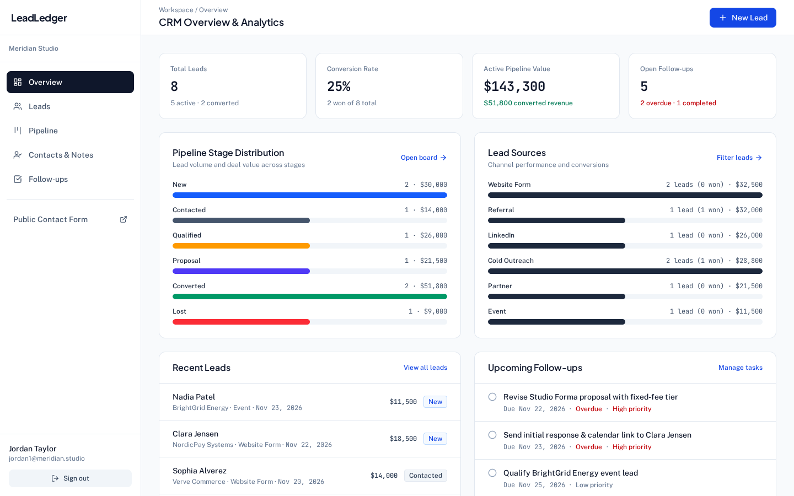
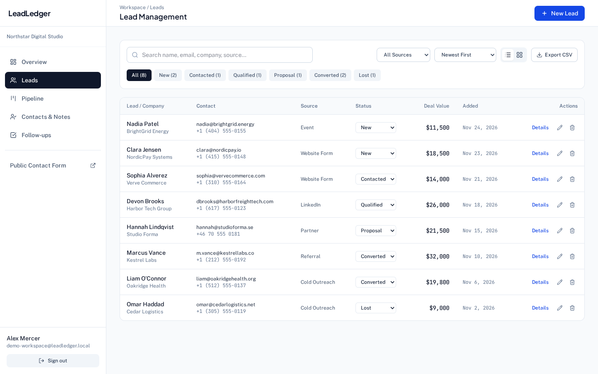
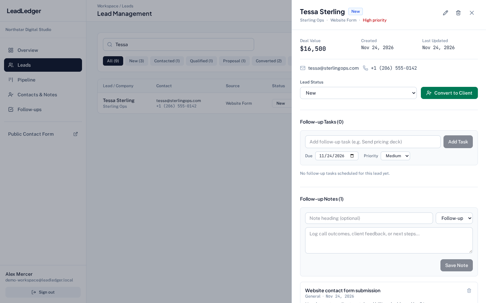
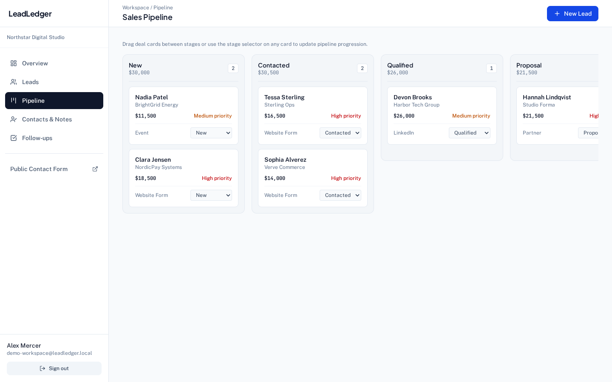
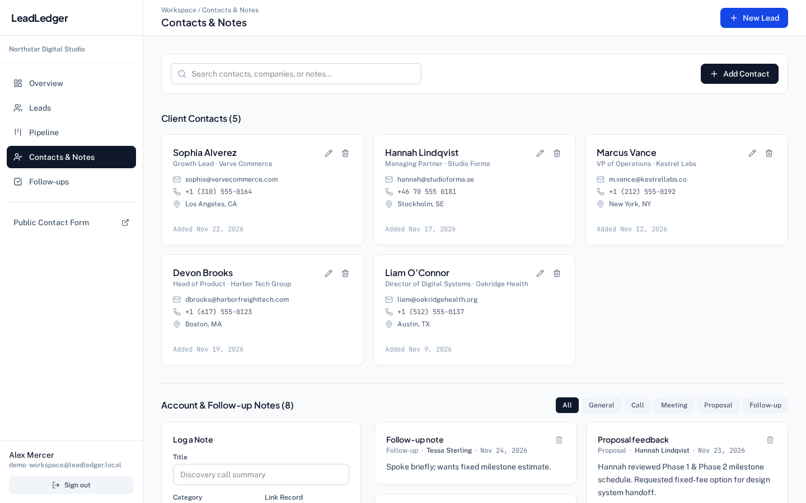
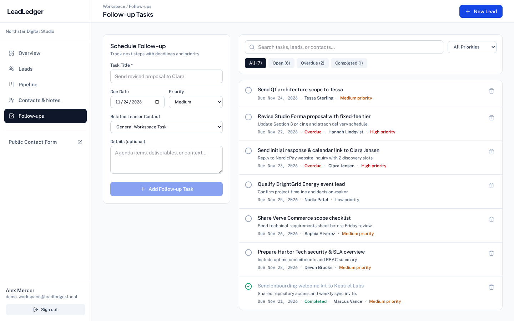
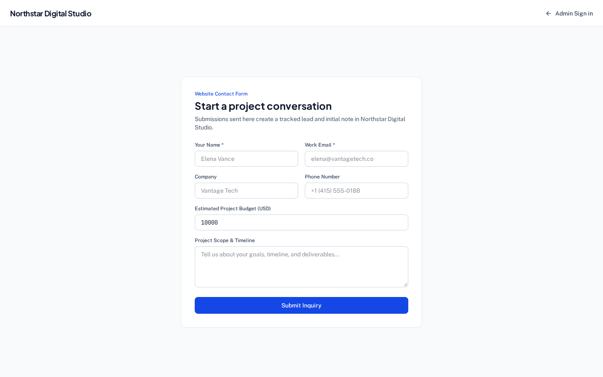
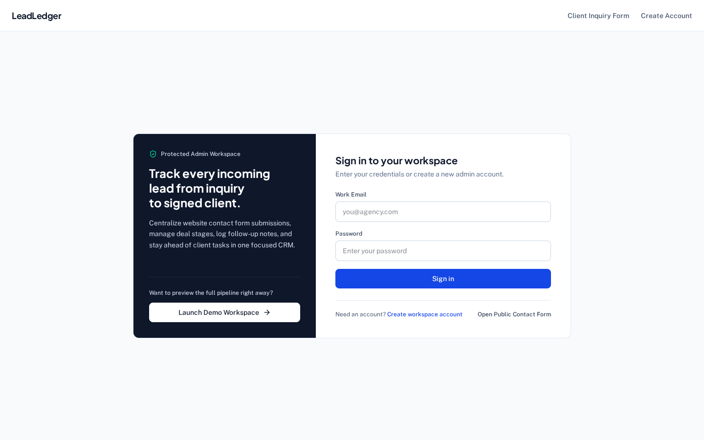

# LeadLedger CRM — Client Lead Management System

A full-stack **Client Lead Management System (Mini CRM)** built with Next.js, React, TypeScript, Tailwind CSS, Node.js, and SQLite. Designed for agencies, freelancers, and startups to capture incoming website inquiries, track lead progression across sales pipeline stages, manage client contacts, log follow-up notes and tasks, and monitor conversion analytics inside an authenticated workspace.

---

## Screenshots

### Dashboard Overview & Analytics


### Lead Management Table & Filters


### Lead Detail Drawer (Status, Conversion, Tasks & Notes)


### Sales Pipeline (Kanban Board)


### Contacts Directory & Follow-up Notes


### Follow-up Tasks


### Public Website Contact Form (`/inquiry`)


### Authentication & Protected Workspace (`/login`)


---

## Key Features

### Authentication & Protected Routes
- **User Registration & Sign-In**: Account creation (`/register`) and login (`/login`) with salted `crypto.scrypt` password hashing and timing-safe verification.
- **Session & Route Protection**: HMAC-SHA256 signed session tokens held in React memory (`Authorization: Bearer`) paired with `HttpOnly` session cookies and same-origin checks for mutations.
- **Protected Workspace**: Unauthenticated access to `/dashboard`, `/leads`, `/pipeline`, `/contacts`, or `/tasks` automatically redirects to `/login`.
- **Demo Workspace**: One-click **Launch Demo Workspace** creates an isolated sample workspace seeded with leads, contacts, notes, and follow-up tasks.

### Public Website Contact Form (`/inquiry`)
- Client-facing inquiry form (`POST /api/public/leads`) that captures prospective client name, email, phone, company, estimated budget, and project scope directly into the CRM database as a `New` lead with an attached initial note.

### Lead Management & Sales Pipeline (`/leads`, `/pipeline`)
- **Full Lead CRUD**: Create, inspect, edit, and delete leads with deal value, source, priority, status, and created/updated timestamps.
- **Search, Filtering & Sorting**: Real-time search across name, email, company, phone, and source; status filter tabs (`New`, `Contacted`, `Qualified`, `Proposal`, `Converted`, `Lost`); source filter; and multi-field sorting.
- **Table & Card Views + CSV Export**: Toggle between compact data table and card grid layouts, and export filtered leads to RFC 4180 CSV with formula-injection protection.
- **Kanban Pipeline Board**: Drag-and-drop deal cards between pipeline stages (with accessible stage dropdowns on every card) and live per-stage count and revenue totals.
- **Lead-to-Client Conversion**: One-click **Convert to Client** in the lead detail drawer marks the lead `Converted` and creates a linked record in Contacts.

### Contacts, Follow-up Notes & Tasks (`/contacts`, `/tasks`)
- **Client Contact Directory**: Searchable directory storing name, email, phone, company, role title, and location.
- **Categorized Notes**: Log notes (`General`, `Call`, `Meeting`, `Proposal`, `Follow-up`) linked to specific leads or contacts, filterable by category and search query.
- **Follow-up Task Tracker**: Schedule tasks with due dates, priority levels (`High`, `Medium`, `Low`), completion toggles, automatic `Overdue` detection, and status/priority filters.

### Dashboard Analytics (`/dashboard`)
- **KPI Summary Strip**: Total leads (active vs. converted), conversion rate, active pipeline value vs. converted revenue, and open/overdue follow-up task counts.
- **Visual Breakdowns**: Pipeline stage distribution and lead acquisition source performance bars with deal counts and values.
- **Action Queues**: Recent incoming leads and upcoming/overdue follow-up checklist.

---

## Tech Stack

- **Frontend**: Next.js App Router, React 19, TypeScript, Tailwind CSS v4, Lucide Icons
- **Backend**: Next.js App Router Route Handler running on the Node.js runtime
- **Database**: SQLite via Node.js built-in `node:sqlite` (`DatabaseSync`) stored in `data/crm.db`
- **Testing**: Node built-in test runner (`node:test`) with `tsx`

---

## Project Structure

```text
├── server/
│   ├── api.ts                 # API endpoint logic used by the Route Handler
│   ├── auth.ts                # Scrypt password hashing, HMAC tokens, and cookie helpers
│   └── db.ts                  # SQLite schema initialization and workspace sample seeding
├── app/
│   ├── api/[...segments]/route.ts # Native Next.js API Route Handler
│   ├── layout.tsx             # Root layout, metadata, global styles and providers
│   ├── providers.tsx          # Client-side auth and CRM context providers
│   └── */page.tsx             # App Router pages
├── src/
│   ├── App.tsx                # Shared protected workspace layout
│   ├── index.css              # Tailwind CSS v4 setup and typography tokens
│   ├── types/
│   │   └── crm.ts             # Shared TypeScript interfaces and status/source constants
│   ├── utils/
│   │   ├── crmLogic.ts        # Pure filtering, sorting, analytics, CSV, and validation logic
│   │   └── crmLogic.test.ts   # Unit tests for core CRM logic
│   ├── context/
│   │   ├── AuthContext.tsx    # In-memory Bearer token and session hydration
│   │   └── CrmContext.tsx     # Leads, contacts, notes, and tasks state & API actions
│   ├── components/
│   │   ├── AppShell.tsx       # Sidebar navigation, breadcrumb header, mobile drawer
│   │   ├── ProtectedRoute.tsx # Route guard redirecting unauthenticated users
│   │   ├── LeadDrawer.tsx     # Slide-over lead details, conversion, notes, and tasks
│   │   ├── LeadModal.tsx      # Create/edit lead dialog with validation
│   │   ├── ContactModal.tsx   # Create/edit contact dialog
│   │   └── StatusLabel.tsx    # Semantic status and priority labels
│   └── screens/
│       ├── LoginPage.tsx      # Sign-in page + Demo Workspace launcher
│       ├── RegisterPage.tsx   # Workspace registration page
│       ├── PublicInquiryPage.tsx # Public website contact form
│       ├── DashboardPage.tsx  # KPI overview, stage/source analytics, action queues
│       ├── LeadsPage.tsx      # Lead table/cards, search, filters, CSV export
│       ├── PipelinePage.tsx   # 6-stage Kanban pipeline board
│       ├── ContactsPage.tsx   # Contacts directory and follow-up notes board
│       └── TasksPage.tsx      # Follow-up task manager
├── package.json               # Bun package manager scripts and dependencies
└── tsconfig.json
```

---

## Getting Started

### Prerequisites
- **Node.js v22.5+** (Next.js and built-in `node:sqlite`)
- **Bun v1.4.4+** (package manager)

### 1. Install Dependencies
```bash
bun install
```

### 2. Run in Development
Starts the Next.js App Router and API on `http://localhost:3000`:
```bash
bun run dev
```

### 3. Build & Run in Production
```bash
bun run build
bun run start
```
`bun run start` runs the built Next.js application. The app uses Node.js APIs and SQLite, so it cannot be deployed as a static export.

---

## Running Tests & Checks

### Unit Tests
Runs deterministic tests for lead filtering, sorting, analytics math, overdue detection, input validation, and CSV escaping:
```bash
bun run test
```

### Type Check
```bash
bun run lint
```

---

## API Overview

### Public & Auth Endpoints
| Method | Endpoint | Description |
| :--- | :--- | :--- |
| `GET` | `/api/health` | Health check |
| `GET` | `/api/auth/session` | Restore current session from `HttpOnly` cookie or Bearer token |
| `POST` | `/api/auth/register` | Register a new workspace user (hashes password with `scrypt`) |
| `POST` | `/api/auth/login` | Authenticate user and issue session token/cookie |
| `POST` | `/api/auth/demo` | Start or open the isolated demo workspace |
| `POST` | `/api/auth/logout` | Clear session cookie |
| `GET` | `/api/public/workspace` | Fetch public workspace display name for the contact form |
| `POST` | `/api/public/leads` | Submit a website inquiry as a `new` lead + initial note |

### Protected CRM Endpoints (Require Authenticated Session)
| Method | Endpoint | Description |
| :--- | :--- | :--- |
| `GET`, `POST` | `/api/leads` | List all workspace leads or create a new lead |
| `PATCH`, `DELETE` | `/api/leads/:id` | Update lead details/status or delete a lead |
| `POST` | `/api/leads/:id/convert` | Mark lead `converted` and create/link a contact record |
| `GET`, `POST` | `/api/contacts` | List or create client contacts |
| `PATCH`, `DELETE` | `/api/contacts/:id` | Update or delete a contact |
| `GET`, `POST` | `/api/notes` | List or create follow-up notes |
| `DELETE` | `/api/notes/:id` | Delete a note |
| `GET`, `POST` | `/api/tasks` | List or create follow-up tasks |
| `PATCH`, `DELETE` | `/api/tasks/:id` | Update/toggle completion or delete a task |
